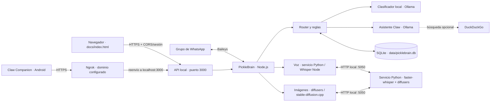

# Cómo funciona PickleBrain y Claw

PickleBrain es el proceso que corre en el ordenador. Mantiene la conexión de
WhatsApp, ejecuta la lógica del bot, consulta los modelos locales de Ollama y
guarda los datos en SQLite. **Claw** es el asistente con el que hablan las
personas desde WhatsApp o desde la interfaz web.

## Mapa del sistema

La web la sirve el propio servidor PickleBrain, no un hosting externo. Ni
GitHub Pages ni ningún servicio estático ejecutan Node.js, Ollama o la base de
datos: el ordenador debe estar encendido y con PickleBrain en marcha para que la
interfaz pueda usar la IA. La aplicación Android es un cliente separado; su
código fuente no está incluido en esta carpeta.

## Qué arranca cada comando

| Comando | Qué inicia |
|---|---|
| `npm start` | `src/index.js`: base SQLite, servidor HTTP, túnel ngrok, conexión WhatsApp, limpieza y avisos programados. |
| `npm run web` | `src/web.js`: base SQLite y servidor HTTP/ngrok, sin iniciar WhatsApp. |
| `npm run sim` | Simulador de mensajes que reutiliza el router sin conectarse a WhatsApp. |
| `npm run doctor` | Diagnósticos de Ollama, modelos, base de datos y componentes disponibles. |
| `npm test` | Suite de integración del bot. |
| `npm run test:web` | Prueba autenticación por email, autorización API, CORS y sesiones temporales. |
| `npm run test:python` | Contrato entre Node y el servicio Python, con un servidor HTTP falso (sin modelos). |
| `npm run ia` | Arranca `python/server.py` (voz e imágenes). En Linux también `npm run ia:linux`. |
| `npm run smtp` | Comprueba las credenciales SMTP de AsterMail; con un correo como argumento envía un código de prueba. |

El servidor HTTP escucha en `127.0.0.1:3000`. Si `NGROK_ENABLED=true`, inicia
`ngrok http 3000 --url https://dawn-greeter-grazing.ngrok-free.dev` y reintenta
cada cinco segundos si el proceso del túnel termina. Al cerrar el servidor,
cierra ngrok también. El dominio es fijo y la web lo usa por defecto; puede
sobreescribirse con `NGROK_DOMAIN`, pero no es necesario. Ngrok debe estar
instalado y autenticado en el equipo anfitrión.

## Recorrido de un mensaje de WhatsApp

1. `src/whatsapp.js` recibe el evento de Baileys, extrae el texto y describe el
   archivo adjunto si lo hay.
2. `src/router.js` aplica las reglas de grupo, permisos, comandos, menciones y
   modo mantenimiento. Los mensajes normales suelen ignorarse en silencio.
3. Las preguntas conocidas de deberes o exámenes se responden directamente con
   datos de SQLite. Otros mensajes pertinentes pasan al clasificador de
   `src/brain.js`, que usa Ollama para producir datos estructurados.
4. `src/memory.js` guarda los apuntes, las preguntas pendientes y, si está
   activado, una ventana limitada de mensajes recientes. Las fechas relativas
   se normalizan mediante `src/dates.js`.
5. Si alguien invoca a Claw, `src/claw.js` construye la respuesta con el
   historial permitido y los apuntes relacionados. La búsqueda en DuckDuckGo
   es opcional y se controla con `WEB_SEARCH`.
6. `src/whatsapp.js` envía las respuestas al chat correspondiente.

Una pregunta escolar puede abrir una pregunta pendiente durante
`ANSWER_WINDOW_MINUTES`. Si alguien contesta en ese intervalo, el router puede
clasificar la respuesta como dato y guardarla. Una rectificación explícita
actualiza el apunte anterior.

## Voz, archivos e imágenes

- **Servicio Python (opcional):** `python/server.py` es un servicio FastAPI que
  escucha solo en `127.0.0.1:5050`. Node lo llama por HTTP con
  `src/python-ai.js`. Hace dos cosas: transcribir audio con faster-whisper y
  generar imágenes con diffusers. Si no está arrancado o falla, el bot sigue con
  los motores antiguos; se controla con `PYTHON_AI_ENABLED` y
  `PYTHON_AI_FALLBACK`.
- **Notas de voz:** `src/transcribe.js` pide la transcripción al servicio Python.
  Si no está disponible, usa ffmpeg para convertir el audio y Whisper local
  (transformers.js) para transcribirlo. El modelo puede descargarse la primera
  vez. Whisper cambia solo a CPU si CUDA está presente pero faltan
  `libcublas`/cuDNN.
- **Fotos y documentos:** `src/media.js` guarda archivos pertinentes en
  `data/media/`, comprueba el espacio disponible y aplica límites de tamaño y
  caducidad. Los documentos dependen de `DOCS_ENABLED`.
- **Generación de imágenes:** `src/imagegen.js` elige motor según
  `IMAGE_GEN_BACKEND`:
  - `auto` (por defecto): Python/diffusers si está disponible; si no, `cli`.
  - `python`: servicio Python con el modelo de `PYTHON_IMAGE_MODEL`.
  - `cli`: Stable Diffusion local desde `sdserver/`.
  - `http`: servidor compatible con OpenAI Images.

  Está desactivada de fábrica y requiere habilitarla expresamente. Con una GPU
  pequeña, `IMAGE_GEN_FREE_VRAM=true` y `PYTHON_IMAGE_UNLOAD=true` liberan la
  VRAM entre Ollama y el dibujo.

## Web, API y Android

`docs/index.html` es la portada que el servidor entrega en `/` y
`docs/entrar/index.html` contiene el acceso de estudiantes en `/entrar/`. También
pueden abrirse con el servidor local en `http://127.0.0.1:3000/` y
`http://127.0.0.1:3000/entrar/`, o a través del túnel ngrok. El acceso usa la
misma URL de PickleBrain que el bot, pide los datos de registro (nombre,
apellidos, curso y grupo) y solicita un código por correo institucional. Tras
entrar, permite chatear con Claw o gestionar apuntes compartidos. El token se
guarda solo en `sessionStorage` y desaparece al cerrar la pestaña.

Además, el dueño puede entrar en **modo debug** escribiendo el código corto de
`WEB_DEBUG_CODE` (por defecto `0912`) en el campo del correo. Esa sesión lleva la
marca `debug: true` y muestra una pestaña de administración con estadísticas,
ajustes del bot y alumnado. Los intentos se limitan por IP. Deja
`WEB_DEBUG_CODE` vacío para desactivarlo.

La API actual incluye:

| Ruta | Uso |
|---|---|
| `POST /api/auth/request-code` | Registra al estudiante y envía un código al correo permitido `@alu.edu.gva.es`. |
| `POST /api/auth/verify` | Verifica el código y entrega un token temporal de sesión. |
| `POST /api/auth/debug` | Acceso de depuración con código corto; crea una sesión de administración. |
| `GET /api/auth/me` | Devuelve identidad, caducidad, marca `debug` y perfil registrado. |
| `POST /api/auth/logout` | Revoca la sesión actual. |
| `GET /api/health` | Estado y capacidades anunciadas por el servidor; requiere sesión. |
| `POST /api/chat` | Conversación con Claw usando Ollama. |
| `GET /api/context` | Lista deberes y exámenes vigentes. |
| `POST /api/context` | Crea un apunte manual. |
| `DELETE /api/context?id=…` | Borra un apunte. |
| `POST /api/imagegen` | Solicita una imagen al motor configurado. |
| `POST /api/transcribe` | Transcribe un audio enviado en Base64. |
| `GET /api/admin/overview` | Estadísticas, ajustes y alumnado; solo sesiones debug. |
| `POST /api/admin/settings` | Cambia o restablece un ajuste; solo sesiones debug. |
| `GET/DELETE /api/admin/students` | Lista o borra registros de alumnado; solo sesiones debug. |
| `/api/settings` y `/api/dev/*` | Rutas heredadas de administración, bloqueadas para cuentas de estudiantes. |
| `GET /api/download-apk` | Redirige al APK `ClawCompanion.apk` adjunto a la última GitHub Release. |

La app Android usa el túnel ngrok para consultar el servidor fuera de la red
doméstica. La API anuncia el enlace de descarga de la última release de
`ClawBott/ClawRepository`; hay que publicar el APK en esa release con el nombre
exacto `ClawCompanion.apk`. Este repositorio contiene el servidor/API, no el
proyecto nativo Android ni el proceso de compilación del APK. Los clientes
anteriores que soliciten `/api/download-apk` reciben una redirección al mismo
recurso de GitHub. Todos los endpoints de API, incluido el enlace de descarga,
requieren una sesión; la versión Android actual tendrá que adaptarse al login
por correo institucional.

### Publicación y seguridad

- El servidor sirve la propia web, así que no hace falta configurar ningún
  hosting. Los orígenes locales y los dominios `*.ngrok-free.app` / `*.ngrok.app`
  se aceptan automáticamente; si usas otro dominio, añádelo a
  `WEB_ALLOWED_ORIGINS` separado por comas y sin `/` final.
- Configura `SMTP_HOST`, `SMTP_PORT`, `SMTP_SECURE`, `SMTP_USER` y
  `SMTP_PASSWORD` en `.env`; el servidor envía los códigos como
  `clawbot@astermail.org`. Nunca publiques las credenciales SMTP.
- Los códigos tienen 6 dígitos, caducan a los 10 minutos, permiten hasta cinco
  intentos y se limitan las solicitudes. Las sesiones expiran a las ocho horas,
  se guardan en memoria y se revocan al cerrar sesión o reiniciar el servidor.
- Todas las rutas operativas `/api/*` exigen un bearer token de sesión, también
  las solicitudes sin `Origin`. Solo solicitar el código, verificar el código y
  el acceso debug están abiertos para iniciar sesión; CORS restringe los sitios
  web autorizados, pero no sustituye la validación del token.
- `WEB_DEBUG_CODE` es una puerta trasera deliberada para el dueño. Cámbialo por
  un valor privado, no lo compartas y vacíalo para desactivarlo. Las sesiones
  normales reciben 403 en `/api/admin/*`.
- Ngrok crea una dirección pública que reenvía al servidor. Mantén SMTP
  configurado y usa HTTPS en el túnel. La app Android actual no implementa
  este flujo y debe actualizarse antes de volver a llamar a la API.
- La web y la API se sirven por HTTPS a través del túnel ngrok, así que el
  navegador no necesita permisos especiales para hablar con el servidor. Abrir
  los archivos con `file://` o llamar a `127.0.0.1` desde fuera no funciona: usa
  siempre la URL del túnel.

## Datos y privacidad

SQLite guarda los deberes, exámenes, preguntas, ajustes dinámicos y, si
`STORE_MESSAGES` está activado, mensajes recientes. La autenticación de WhatsApp está en
`data/auth/`; los archivos descargados o temporales están bajo `data/`. No
compartas esas carpetas ni el `.env`.

La generación de respuestas y la transcripción ocurren localmente. Hay
excepciones de red que conviene conocer:

- WhatsApp transmite los mensajes a través de su servicio y Baileys mantiene la
  sesión con WhatsApp Web.
- Ollama y Whisper pueden descargar sus modelos durante la instalación o el
  primer uso.
- Con `WEB_SEARCH=true`, la pregunta que requiere actualidad se envía a
  DuckDuckGo.
- El túnel ngrok transporta tanto la web como las solicitudes de Android entre
  Internet y el servidor local.

Para evitar la búsqueda externa, configura `WEB_SEARCH=false`. Para revisar
todas las opciones, consulta `.env.example`.

## Módulos principales

| Archivo | Responsabilidad |
|---|---|
| `src/index.js` | Arranque completo, WhatsApp y tareas periódicas. |
| `src/web.js` | Arranque solo de la API y la web local. |
| `src/server.js` | HTTP, API, CORS, restricciones web y túnel ngrok. |
| `src/web-auth.js` | Códigos institucionales de un uso, límites y sesiones temporales. |
| `src/whatsapp.js` | Sesión Baileys, eventos y envío de mensajes. |
| `src/router.js` | Flujo de mensajes y decisiones del bot. |
| `src/brain.js` | Clasificación estructurada con Ollama. |
| `src/claw.js` | Asistente conversacional, contexto y búsqueda opcional. |
| `src/ollama.js` | Cliente HTTP de Ollama y selección de modelos. |
| `src/memory.js` | Esquema SQLite y operaciones de persistencia. |
| `src/config.js` | Configuración desde `.env` y valores predeterminados. |
| `src/dates.js`, `src/subjects.js`, `src/signals.js` | Fechas, asignaturas y detección rápida basada en texto. |
| `src/media.js`, `src/transcribe.js`, `src/imagegen.js` | Gestión de archivos, voz e imágenes. |
| `src/python-ai.js` | Cliente del servicio Python local (salud, transcripción e imágenes). |
| `python/server.py` | Servicio FastAPI de voz (faster-whisper) e imágenes (diffusers). |
| `src/tools/` | Simulador, diagnósticos y pruebas; `web-auth-test.js` cubre el acceso institucional y `python-ai-test.js` el contrato con Python. |
