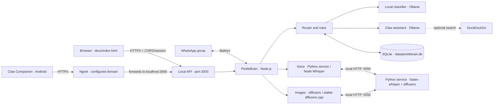

# How PickleBrain and Claw work

PickleBrain is the process that runs on the computer. It keeps the WhatsApp
connection open, runs the bot logic, queries the local Ollama models and stores
data in SQLite. **Claw** is the assistant people talk to from WhatsApp or from
the web interface.

## System map

The website is served by the PickleBrain server itself, not by external hosting.
Neither GitHub Pages nor any static service can run Node.js, Ollama or the
database: the computer must be on and PickleBrain running for the interface to
use the AI. The Android app is a separate client; its source code is not
included in this folder.

## What each command starts

| Command | What it starts |
|---|---|
| `npm start` | `src/index.js`: SQLite database, HTTP server, ngrok tunnel, WhatsApp connection, cleanup and scheduled notices. |
| `npm run web` | `src/web.js`: SQLite database and HTTP/ngrok server, without starting WhatsApp. |
| `npm run sim` | Message simulator that reuses the router without connecting to WhatsApp. |
| `npm run doctor` | Diagnostics for Ollama, models, database and available components. |
| `npm test` | Bot integration suite. |
| `npm run test:web` | Tests email authentication, API authorization, CORS and temporary sessions. |
| `npm run test:python` | Contract between Node and the Python service, with a fake HTTP server (no models). |
| `npm run ia` | Starts `python/server.py` (voice and images). On Linux also `npm run ia:linux`. |
| `npm run smtp` | Checks the AsterMail SMTP credentials; with an email as argument it sends a test code. |

The HTTP server listens on `127.0.0.1:3000`. If `NGROK_ENABLED=true`, it starts
`ngrok http 3000 --url https://dawn-greeter-grazing.ngrok-free.dev` and retries
every five seconds if the tunnel process exits. When the server shuts down, it
closes ngrok too. The domain is fixed and the website uses it by default; it can
be overridden with `NGROK_DOMAIN`, but that is not necessary. Ngrok must be
installed and authenticated on the host machine.

## The journey of a WhatsApp message

1. `src/whatsapp.js` receives the Baileys event, extracts the text and describes
   the attachment if there is one.
2. `src/router.js` applies the group rules, permissions, commands, mentions and
   maintenance mode. Ordinary messages are usually ignored silently.
3. Known homework or exam questions are answered directly from SQLite. Other
   relevant messages go to the classifier in `src/brain.js`, which uses Ollama
   to produce structured data.
4. `src/memory.js` stores the notes, the pending questions and, if enabled, a
   limited window of recent messages. Relative dates are normalised through
   `src/dates.js`.
5. If someone invokes Claw, `src/claw.js` builds the reply from the allowed
   history and the related notes. DuckDuckGo search is optional and controlled
   by `WEB_SEARCH`.
6. `src/whatsapp.js` sends the replies to the corresponding chat.

A school question can open a pending question for `ANSWER_WINDOW_MINUTES`. If
someone answers within that window, the router can classify the answer as data
and store it. An explicit correction updates the previous note.

## Voice, files and images

- **Python service (optional):** `python/server.py` is a FastAPI service that
  listens only on `127.0.0.1:5050`. Node calls it over HTTP from
  `src/python-ai.js`. It does two things: transcribe audio with faster-whisper
  and generate images with diffusers. If it is not running or it fails, the bot
  keeps using the legacy engines; controlled by `PYTHON_AI_ENABLED` and
  `PYTHON_AI_FALLBACK`.
- **Voice notes:** `src/transcribe.js` asks the Python service for the
  transcription. If it is not available, it uses ffmpeg to convert the audio and
  local Whisper (transformers.js) to transcribe it. The model may be downloaded
  the first time. Whisper switches to CPU by itself if CUDA is present but
  `libcublas`/cuDNN are missing.
- **Photos and documents:** `src/media.js` stores relevant files in
  `data/media/`, checks available space and applies size and expiry limits.
  Documents depend on `DOCS_ENABLED`.
- **Image generation:** `src/imagegen.js` picks the engine from
  `IMAGE_GEN_BACKEND`:
  - `auto` (default): Python/diffusers when available; otherwise `cli`.
  - `python`: Python service with the `PYTHON_IMAGE_MODEL` model.
  - `cli`: local Stable Diffusion from `sdserver/`.
  - `http`: an OpenAI Images compatible server.

  It is disabled out of the box and must be enabled explicitly. With a small
  GPU, `IMAGE_GEN_FREE_VRAM=true` and `PYTHON_IMAGE_UNLOAD=true` free VRAM
  between Ollama and drawing.

## Web, API and Android

`docs/index.html` is the landing page the server serves at `/` and
`docs/entrar/index.html` holds the student login at `/entrar/`. They can also be
opened with the local server at `http://127.0.0.1:3000/` and
`http://127.0.0.1:3000/entrar/`, or through the ngrok tunnel. Login uses the
same PickleBrain URL as the bot, asks for the registration details (name,
surname, course and group) and requests a code by institutional email. Once
inside, it allows chatting with Claw or managing shared notes. The token is kept
only in `sessionStorage` and disappears when the tab is closed.

The owner can also enter **debug mode** by typing the short code from
`WEB_DEBUG_CODE` (default `0912`) in the email field. That session carries the
`debug: true` flag and shows an administration tab with statistics, bot settings
and students. Attempts are limited per IP. Leave `WEB_DEBUG_CODE` empty to
disable it.

The current API includes:

| Route | Purpose |
|---|---|
| `POST /api/auth/request-code` | Registers the student and sends a code to the allowed `@alu.edu.gva.es` address. |
| `POST /api/auth/verify` | Verifies the code and issues a temporary session token. |
| `POST /api/auth/debug` | Debug access with a short code; creates an administration session. |
| `GET /api/auth/me` | Returns identity, expiry, the `debug` flag and the registered profile. |
| `POST /api/auth/logout` | Revokes the current session. |
| `GET /api/health` | Status and capabilities announced by the server; requires a session. |
| `POST /api/chat` | Conversation with Claw using Ollama. |
| `GET /api/context` | Lists current homework and exams. |
| `POST /api/context` | Creates a manual note. |
| `DELETE /api/context?id=…` | Deletes a note. |
| `POST /api/imagegen` | Requests an image from the configured engine. |
| `POST /api/transcribe` | Transcribes audio sent in Base64. |
| `GET /api/admin/overview` | Statistics, settings and students; debug sessions only. |
| `POST /api/admin/settings` | Changes or resets a setting; debug sessions only. |
| `GET/DELETE /api/admin/students` | Lists or deletes student records; debug sessions only. |
| `/api/settings` and `/api/dev/*` | Legacy administration routes, blocked for student accounts. |
| `GET /api/download-apk` | Redirects to the `ClawCompanion.apk` asset attached to the latest GitHub Release. |

The Android app uses the ngrok tunnel to reach the server outside the home
network. The API advertises the download link of the latest release of
`ClawBott/ClawRepository`; the APK must be published on that release with the
exact name `ClawCompanion.apk`. This repository contains the server/API, not the
native Android project or the APK build process. Older clients requesting
`/api/download-apk` receive a redirect to the same GitHub resource. Every API
endpoint, including the download link, requires a session; the current Android
version will have to adapt to institutional email login.

### Publishing and security

- The server serves the website itself, so no hosting needs to be configured.
  Local origins and the `*.ngrok-free.app` / `*.ngrok.app` domains are accepted
  automatically; if you use another domain, add it to `WEB_ALLOWED_ORIGINS`
  separated by commas and without a trailing `/`.
- Configure `SMTP_HOST`, `SMTP_PORT`, `SMTP_SECURE`, `SMTP_USER` and
  `SMTP_PASSWORD` in `.env`; the server sends the codes as
  `clawbot@astermail.org`. Never publish the SMTP credentials.
- Codes have 6 digits, expire after 10 minutes, allow up to five attempts and
  requests are rate limited. Sessions expire after eight hours, are kept in
  memory and are revoked on logout or when the server restarts.
- Every operational `/api/*` route requires a session bearer token, including
  requests without an `Origin`. Only requesting the code, verifying the code and
  debug access are open in order to sign in; CORS restricts the authorised
  websites, but it does not replace token validation.
- `WEB_DEBUG_CODE` is a deliberate backdoor for the owner. Change it to a
  private value, do not share it and empty it to disable it. Normal sessions get
  a 403 on `/api/admin/*`.
- Ngrok creates a public address that forwards to the server. Keep SMTP
  configured and use HTTPS on the tunnel. The current Android app does not
  implement this flow and must be updated before calling the API again.
- The website and the API are served over HTTPS through the ngrok tunnel, so the
  browser needs no special permissions to talk to the server. Opening the files
  with `file://` or calling `127.0.0.1` from outside does not work: always use
  the tunnel URL.

## Data and privacy

SQLite stores homework, exams, questions, dynamic settings and, if
`STORE_MESSAGES` is enabled, recent messages. WhatsApp authentication lives in
`data/auth/`; downloaded or temporary files are under `data/`. Do not share
those folders or the `.env`.

Reply generation and transcription happen locally. There are network exceptions
worth knowing about:

- WhatsApp transmits the messages through its service and Baileys keeps the
  session with WhatsApp Web.
- Ollama and Whisper may download their models during installation or first use.
- With `WEB_SEARCH=true`, a question that needs current information is sent to
  DuckDuckGo.
- The ngrok tunnel carries both the website and the Android requests between the
  Internet and the local server.

To avoid external search, set `WEB_SEARCH=false`. To review every option, see
`.env.example`.

## Main modules

| File | Responsibility |
|---|---|
| `src/index.js` | Full startup, WhatsApp and periodic tasks. |
| `src/web.js` | Startup of the API and local website only. |
| `src/server.js` | HTTP, API, CORS, web restrictions and ngrok tunnel. |
| `src/web-auth.js` | Single-use institutional codes, limits and temporary sessions. |
| `src/whatsapp.js` | Baileys session, events and message sending. |
| `src/router.js` | Message flow and bot decisions. |
| `src/brain.js` | Structured classification with Ollama. |
| `src/claw.js` | Conversational assistant, context and optional search. |
| `src/ollama.js` | Ollama HTTP client and model selection. |
| `src/memory.js` | SQLite schema and persistence operations. |
| `src/config.js` | Configuration from `.env` and default values. |
| `src/dates.js`, `src/subjects.js`, `src/signals.js` | Dates, subjects and fast text-based detection. |
| `src/media.js`, `src/transcribe.js`, `src/imagegen.js` | File handling, voice and images. |
| `src/python-ai.js` | Client for the local Python service (health, transcription and images). |
| `python/server.py` | FastAPI service for voice (faster-whisper) and images (diffusers). |
| `src/tools/` | Simulator, diagnostics and tests; `web-auth-test.js` covers institutional access and `python-ai-test.js` the contract with Python. |
